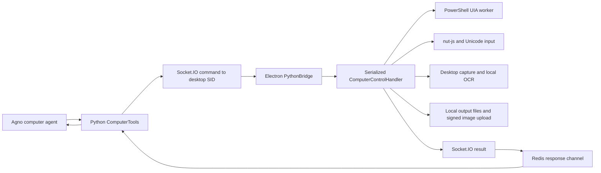
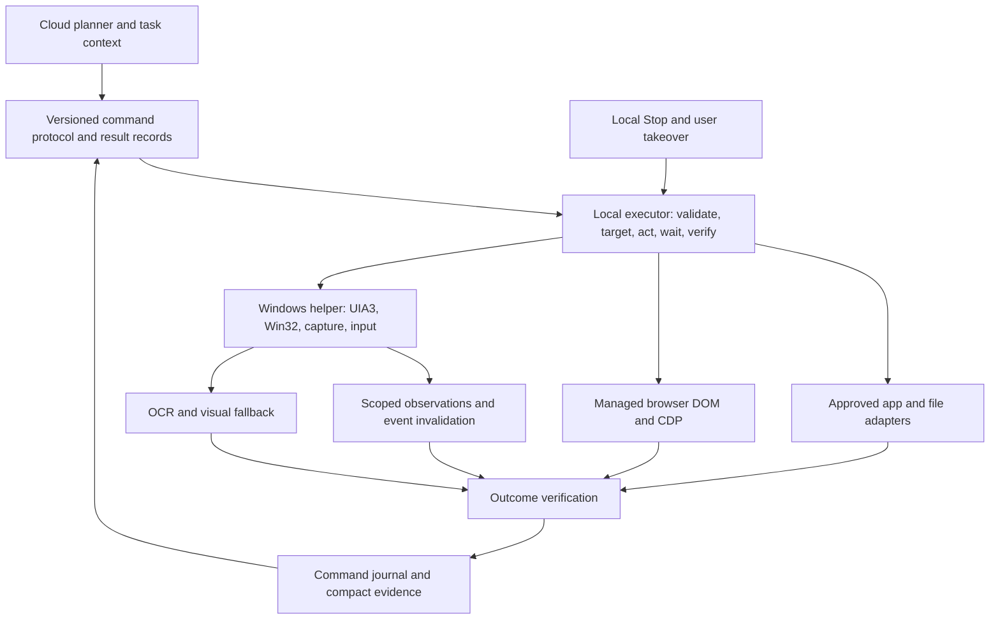

# Windows computer-use research and architecture review

Research date: 13 October 2026. Scope: Aetheria's Windows desktop and managed-browser execution paths. This is an analysis and implementation proposal; it does not change application behavior.

## Recommendation

Keep the existing Electron, Python, Socket.IO and Redis architecture. Improve the local execution loop before adding another agent framework.

The largest practical gains should come from locally verified actions, conditional screenshots, reliable command recovery, scoped accessibility queries, and fewer model round trips. A Windows native helper is a useful next step after instrumentation identifies the remaining UIA and capture costs. Replacing nut-js alone will not solve stale observations, uncertain outcomes, focus changes, or disconnected results.

My recommended order is:

1. Fix the concrete targeting and verification defects described below.
2. Add command lifecycle records, cancellation and desktop ownership across chats.
3. Add local `act_and_wait`, condition-based waits and bounded action sequences.
4. Reduce screenshot and accessibility work on the normal path.
5. Pilot a typed Windows helper using UIA3 and Windows Graphics Capture.
6. Add app-specific adapters and a measured visual fallback for custom controls.

These priorities are engineering judgments based on the inspected code. No end-to-end speedup or universal application success rate has been measured in this review.

## Evidence and limits

I read the agent configuration, Python desktop toolkit, backend result routing and run controls, Electron command dispatcher, persistent Windows accessibility worker, generated UIA scripts, native keyboard and typing code, managed-browser handler, lazy controller wiring, current audit, architecture documentation and relevant tests.

Checks run during this review:

| Check | Result | What it establishes |
| --- | --- | --- |
| `npm run test:computer-control` | 29 passed | Existing handler, worker and reliability regressions pass |
| `python -m pytest python-backend/tests/test_computer_tools.py -q` | 13 passed | Toolkit payloads, response handling and deadline tests pass |
| Four controlled handler probes | Four expected gaps reproduced | Raw point targeting, long-value verification, failed refresh semantics and screenshot age handling |
| Controlled browser/bridge probes | Two expected gaps reproduced | Two click events in fallback and no buffering of disconnected results |

The probes called real methods with fake input, UIA, capture, clock or page dependencies. They did not inject desktop input or operate on personal applications. The 4,001-character probe supplied the same truncated observation a successful field update would produce; it did not establish that a particular real app accepts that value. The browser probe counted callback-generated events in a fake element, not a real website transaction.

I did not rerun the opt-in Calculator/form/OCR GUI workflows, run an authenticated deployed agent, build an installer, install competing projects, or benchmark models. Existing GUI measurements below are historical evidence from the repository's [computer-control audit](C:/Users/prajw/Downloads/AI-OS/docs/computer-control-audit.md), not fresh measurements.

The broad documentation needs reconciliation with the code. [Architecture documentation](C:/Users/prajw/Downloads/AI-OS/docs/02-ARCHITECTURE.md:123) describes Playwright, while the desktop handler uses Puppeteer. It lists some older socket event names. The docs index also links to agent/tool/security documents absent from this checkout. The code and recent computer-control audit are the stronger evidence for current behavior.

## Current execution path

The model selects individual operations. Each desktop tool creates a UUID, subscribes to a Redis response channel, emits a command to the desktop SID, and waits. The Electron handler executes commands in one queue and caches recent results. Accessibility operations use a persistent PowerShell process connected through private standard-input/output pipes. Screenshots use Electron screen thumbnails cropped to window bounds. The backend converts returned image bytes or a backend media file into model image input.

The managed browser is a separate Puppeteer/CDP executor with its own queue. Browser and native desktop input do not share a workflow ownership mechanism in these handlers.

Relevant entry points are [computer_agent.py](C:/Users/prajw/Downloads/AI-OS/python-backend/computer_agent.py:95), [computer_tools.py](C:/Users/prajw/Downloads/AI-OS/python-backend/computer_tools.py:189), [python-bridge.js](C:/Users/prajw/Downloads/AI-OS/js/python-bridge.js:309), [main.js](C:/Users/prajw/Downloads/AI-OS/js/main.js:517) and [computer-control-handler.js](C:/Users/prajw/Downloads/AI-OS/js/computer-control-handler.js:123).

### What is already worth keeping

- Exact input coordinates and validation rather than random click offsets.
- A serialized handler queue, duplicate request handling and a bounded result cache.
- Window-scoped accessibility, ambiguous-name rejection, runtime-ID re-resolution and expired-reference rejection.
- Accessibility actions with supported-pattern information and refreshed state.
- Unicode handling, saved typing pace and cleanup of held keys/buttons.
- DPI-aware screenshot origins, display IDs and image-relative coordinate mapping.
- Local OCR with a reused worker and confidence information.
- Backend monotonic waits, Redis subscription readiness and queued-command expiry.
- Locked-session checks and preservation of accessibility state when capture fails.

The earlier audit reports warm UIA observations at 169–317 ms, semantic action plus refresh at 294–549 ms, window screenshot plus accessibility around 2.5–2.7 seconds, and warm OCR around 1.6 seconds. These small local samples exclude model inference, authenticated transport and screenshot upload. They suggest that avoiding unnecessary observation work deserves testing; they do not identify today's end-to-end bottleneck conclusively.

## Concrete defects and missing guarantees

| Priority | Finding | Evidence | Consequence and cheapest useful check |
| --- | --- | --- | --- |
| First | `window_id` verifies foreground focus but raw click/scroll coordinates have no window ownership check | [Input preparation](C:/Users/prajw/Downloads/AI-OS/js/computer-control-handler.js:1218), [click](C:/Users/prajw/Downloads/AI-OS/js/computer-control-handler.js:1245). Fake-input probe accepted `900000,900000` with a target HWND | Coordinates can reach another window or fall outside the display. Test a target window covered by a popup and a point outside its bounds |
| First | Screenshot freshness starts after local saving and upload | [Screenshot registration](C:/Users/prajw/Downloads/AI-OS/js/computer-control-handler.js:931), [mapping](C:/Users/prajw/Downloads/AI-OS/js/computer-control-handler.js:1102). Simulated 40-second delay still produced an accepted reference | The 30-second TTL does not measure frame age. Store capture time and test expiry during a delayed upload |
| First | Browser fallback produces two click events | [Fallback](C:/Users/prajw/Downloads/AI-OS/js/browser-handler.js:654) calls `el.click()` and then dispatches another `click`. Fake page probe counted two | An event handler may run twice. Verify one activation in a real fixture with an obscured button |
| First | Long field replacement cannot verify beyond the 4,000-character observation limit | [Value truncation](C:/Users/prajw/Downloads/AI-OS/js/windows-accessibility.js:59), [replacement verification](C:/Users/prajw/Downloads/AI-OS/js/computer-control-handler.js:2070). 4,001-character probe returned `verified: false` | Valid input up to the accepted 100,000-character limit can be reported as unknown. Compare the full value locally; return a bounded preview separately |
| First | Action lookup inherits an observation output cap | [UIA loop](C:/Users/prajw/Downloads/AI-OS/js/windows-accessibility.js:11) stops after 200 visible results by default, including action requests | A filtered or 500-element observation can identify a later control that the unfiltered action lookup never reaches. Separate lookup budget from output limit; test a target after 250 controls |
| First | Stop does not interrupt an in-flight desktop command | [Run control gate](C:/Users/prajw/Downloads/AI-OS/python-backend/run_control.py:1), [stream checkpoint](C:/Users/prajw/Downloads/AI-OS/python-backend/agent_runner.py:1103), [desktop wait](C:/Users/prajw/Downloads/AI-OS/python-backend/computer_tools.py:189) | Stop is checked between streamed chunks; typing/OCR/shell work has no task cancellation token. Test Stop during paced typing and an active helper request |
| First | Disconnected results are discarded | [sendComputerResult](C:/Users/prajw/Downloads/AI-OS/js/python-bridge.js:381). Probe sent no result after reconnection | An action can complete while the agent sees a timeout. Add acknowledged result delivery and reconciliation; disconnect immediately after input |
| Next | Accessibility action can report dispatch success while refreshed state fails | [Action return](C:/Users/prajw/Downloads/AI-OS/js/computer-control-handler.js:2070). Probe returned outer `success` with inner state `error` | The prompt explains dispatch semantics, but callers still need explicit outcome fields. Test a successful Invoke followed by provider failure |
| Next | Desktop commands target a stored SID rather than a stable device identity | [Command emission](C:/Users/prajw/Downloads/AI-OS/python-backend/computer_tools.py:241), [reconnect](C:/Users/prajw/Downloads/AI-OS/js/python-bridge.js:172) | Conversation rejoining does not update an existing toolkit's SID. Test a disconnect/reconnect between two commands in one active turn |
| Next | External application changes do not invalidate observations immediately | [Snapshot creation](C:/Users/prajw/Downloads/AI-OS/js/computer-control-handler.js:2037), [screenshot validation](C:/Users/prajw/Downloads/AI-OS/js/computer-control-handler.js:1102) | Bounds checks miss changed content at unchanged coordinates. Test a same-size modal/overlay and user interaction between observe and act |
| Next | UIA is repeatedly walked and properties/patterns are fetched without an explicit cache request | [UIA script](C:/Users/prajw/Downloads/AI-OS/js/windows-accessibility.js:40) | Large apps can spend time on provider calls. Trace node/property counts and compare scoped cached queries |
| Next | Only seven semantic actions are exposed | [Action set](C:/Users/prajw/Downloads/AI-OS/js/windows-accessibility.js:8) | Scrollable lists, sliders and virtualized items often fall back to input. Test Scroll, ScrollItem, RangeValue, ItemContainer and VirtualizedItem support on actual target apps |

The action lookup issue is a code finding, not a live 250-control reproduction. Input cancellation, SID recovery and external-change handling are missing guarantees visible in the inspected paths, not measurements of failure frequency.

Two additional boundaries need attention. The `request_permission` tool directly enables control and defaults filesystem scope to the user's home directory. The shell tool is not constrained by that filesystem scope; its short string blacklist is not an authorization policy. Separately, the backend computer-result event publishes by supplied request ID without checking the expected sender, device or run. UUID randomness reduces guessing but does not establish ownership. Add explicit capability grants and a pending-command ownership record. I did not demonstrate a deployed exploit.

## Proposed Windows architecture

The cloud model decides the task and handles ambiguous choices. The local executor resolves fresh targets, checks preconditions, executes short steps, waits for expected state, and records evidence. It returns to the model when a condition fails or a choice requires reasoning. This keeps deterministic timing and recovery near the applications.

### Choose the strongest available action method

| Application or task | Preferred method | Verification |
| --- | --- | --- |
| Files, directories and document data | Existing validated filesystem operations or document adapters | File exists; expected content, structure or hash matches |
| Connected email, Drive or Sheets task | Authorized service tools already available to this agent | Returned object ID and an independent read when needed |
| Managed web application | DOM/CDP interaction with fresh locators | Expected field, URL, dialog, record or download |
| Accessible Windows app | UIA pattern action | Value/state/window condition on a fresh control |
| Office or another app with a supported local API | Narrow, app-specific adapter bound to the intended document | Read the target document's resulting data |
| Custom-drawn editor or canvas | Window capture, visual grounding, OCR and scoped input | Visible state plus exported artifact/API read if available |
| Missing target, privilege block or unresolved ambiguity | Reobserve or return a specific failure | No blind repeat of an uncertain action |

Do not add a native API just because one exists. It must act on the user's intended document, preserve the expected workflow and provide a reliable outcome check. Bulk changes to a spreadsheet are good adapter candidates; a designer's arbitrary canvas gesture may still need GUI interaction.

### Make actions include the wait and outcome

Add a small set of useful operations, retaining existing low-level tools for fallback:

- `observe_window` with focused, interactive, subtree and screenshot modes.
- `find_controls` with AutomationId, role, name and ancestor scope, returning all matches.
- `act_and_wait` with target, preconditions, action and expected result.
- `wait_for_state` for a field value, toggle state, new dialog, closed window or app readiness.
- `execute_sequence` for a short, bounded list of locally verified steps.
- `cancel_run` and `get_command_status` for immediate local interruption and recovery.

These are proposed contracts, not implemented tools. Avoid making the model send arbitrary local code or invent executable verification expressions. Conditions should use a typed, limited vocabulary.

For example, a checkbox operation should request `ensure_toggle_state = On`. The executor reads its state, does nothing if already On, toggles if Off, waits, and confirms On. Repeating a raw `toggle` after a lost response can reverse a successful action.

Use explicit result fields such as `execution = not_started | dispatched | completed`, `verification = passed | failed | unavailable`, an error code, and a retry classification. Keep any compatibility `status` field until Python and desktop clients migrate together.

For Invoke, the requested outcome might be a Save dialog or an expected file, not merely a completed UIA call. Verify the particular task condition. No framework can infer that condition perfectly for every application.

### Batch short steps without executing blind plans

Let the model request a small sequence such as fill two named fields, ensure a checkbox is selected, and stop before submission. Resolve each target immediately before its step. Check expected state after each mutation. Stop the sequence on a dialog, failed condition, stale target, user takeover or cancellation.

Do not reuse today's observation IDs across a batch, since every mutation intentionally invalidates them. Sequence steps need stable selectors and fresh resolution, with the same ambiguity checks as individual actions.

Keep foreground input serialized. Parallelize independent reads only when they cannot change focus or observe incompatible states. Independent headless browser/API operations can use separate resources. Two agents should not click the same desktop concurrently.

## Speed improvements tied to this code

### Measure the whole path

Attach a trace ID and record queue wait, target resolution, focus, UIA, capture, encoding, local save, upload, transport, verification and model time. Use monotonic clocks within each process. Include app version, node counts, output bytes, input/output tokens and image count. Do not log document text, secrets or full screenshot bytes in metrics.

Collect p50 and p95 separately for cold and warm runs. A local 200 ms observation can still participate in a multi-second model/tool cycle. Measure before choosing whether the next investment belongs in native code, transport or the model.

### Remove routine screenshot uploads

`get_window_state` defaults to screenshots even though it already supports accessibility-only observations. `_getWindowState` obtains UIA state, then captures and saves a PNG, then awaits signed upload before returning. That work stays inside the serialized command queue.

Default reliable semantic steps to compact accessibility evidence. Capture an image when accessibility is missing, a visual condition matters, the local state disagrees, or the model asks for one. Preserve a separate preview/archive path where required.

Record frame time before encoding/upload. For model images, support bounded resolution, a relevant crop, explicit scale and an exact image-to-screen transform. Keep full-resolution evidence locally when useful. Test whether PNG or JPEG preserves the small text needed by each workflow; the browser already uses JPEG quality 72, but that does not establish a universal quality setting.

Do not promise that moving upload to a background task eliminates model-image transfer. If the model needs that frame, it still needs delivery. The gain comes from omitting unnecessary images and avoiding blocking input ownership while unrelated preview work finishes.

### Query less UIA data

The script currently traverses controls, reads current properties and probes patterns on each matching element. It does that again to resolve actions. `_physicalWindowBounds` also uses the UIA script simply to retrieve bounds.

Use bounded queries rooted in the intended window or container, selective property requests, compact action state and explicit document-text reads. Add parent/container context so duplicate labels can be disambiguated. Retain traversal budgets and report truncation. Microsoft describes UIA cache requests as a way to bulk-fetch requested properties and avoid repeated cross-process retrieval. [UIA caching](https://learn.microsoft.com/en-us/windows/win32/winauto/uiauto-cachingforclients).

Use cached observations for planning, then re-resolve live elements and recheck required properties before mutation. Cache data is not authority to click a stale control.

### Replace generic sleeps with expected-state waits

Browser click currently waits 300 ms for smooth scrolling, then may wait up to 5 seconds for network idle, then captures/uploads a view. Long-lived connections can consume that wait budget without improving readiness. Field entry also waits for network idle.

Wait for the specific target to be visible, enabled, stable and able to receive events, then wait for the expected application result. Use bounded polling where no reliable event exists. Playwright documents these actionability checks and retrying assertions; the same principle can be implemented with the current Puppeteer executor or piloted through a locator-based adapter. A browser-library migration should depend on measured maintenance and reliability gains. [Playwright actionability](https://playwright.dev/docs/actionability).

Remove the duplicate click event. If a click may already have dispatched before an error, inspect the outcome before trying another strategy. Automatically forcing JavaScript activation through an overlay can operate a control the visible UI intentionally blocks.

### Respect saved typing pace

Instant typing already pastes a whole string. Fast/Slow sends one Unicode character per helper request, with pauses; control characters use a paste path that waits 200 ms. A faster helper could accept a whole text operation and pace locally, with cancellation/focus checks between small chunks.

The generated UIA script contains direct `ValuePattern.SetValue`, but the actual dispatcher intentionally uses focus, Select All, Backspace and typing so the user's pace applies. Do not silently bypass that preference. Compare direct pattern entry for an explicitly suitable Instant path with existing paste, including apps whose event handling differs.

## Windows helper and targeting details

My preferred pilot is a self-contained C# helper using FlaUI/UIA3, with narrow native interop for capture and input. Keep the helper behind the existing dispatcher so its implementation can be compared with PowerShell. FlaUI wraps Microsoft's UIA APIs, exposes native objects and supports UIA2/UIA3; its own documentation notes application-dependent differences. Treat UIA3 as the candidate default and test compatibility, not as a guarantee. [FlaUI](https://github.com/FlaUI/FlaUI).

Use typed JSON messages over parent-owned pipes, not arbitrary script execution. Keep the helper out of Electron's UI thread, give it a watchdog, and explicitly own COM objects on a dedicated MTA thread. The current worker already isolates provider calls in another process, which is useful, but its startup does not explicitly request MTA. Microsoft recommends a non-UI MTA thread for broad UIA clients and controlled event subscription lifecycle. [UIA threading](https://learn.microsoft.com/en-us/windows/win32/winauto/uiauto-threading).

The helper should support:

- Window identity including HWND, process ID and process start identity. Recycled HWNDs must not bind an old task to a new process.
- Focused/subtree queries, fresh selector resolution, expanded patterns and complete-value verification without returning unlimited text.
- Target-scoped events for focus, structure, value and window changes; coalesced invalidation rather than a full tree scan on every event. Retain polling deadlines because providers may omit useful events. [UIA events](https://learn.microsoft.com/en-us/windows/win32/winauto/uiauto-eventsforclients).
- Bounds through appropriate Win32/DWM APIs instead of a control traversal solely for geometry. Validate coordinate units and frame/client bounds. [DWM window attributes](https://learn.microsoft.com/en-us/windows/win32/api/dwmapi/nf-dwmapi-dwmgetwindowattribute).
- HWND-targeted Windows Graphics Capture, with explicit capability/error reporting. Microsoft provides `CreateForWindow` for creating a capture item for a window. Test occluded, minimized, protected, spanning-display and resized windows before declaring support. [Window capture interop](https://learn.microsoft.com/en-us/windows/win32/api/windows.graphics.capture.interop/nf-windows-graphics-capture-interop-igraphicscaptureiteminterop-createforwindow).
- A screen-capture fallback when the task includes menus/popups outside the original frame. DXGI Desktop Duplication exposes dirty/move regions that can reduce repeated processing; use it only if screen-capture measurements justify another backend. [Desktop Duplication](https://learn.microsoft.com/en-us/windows/win32/direct3ddxgi/desktop-dup-api).

A window image is not an input boundary. Before a coordinate gesture, validate the point against the intended window, then hit-test its current owner/root and any explicitly allowed owned popup. Recheck foreground and user takeover immediately before input. A toast or topmost overlay can cover coordinates while the underlying window stays foreground. `WindowFromPoint` is one useful check, with documented limitations around hidden, disabled and static controls; combine it with the window hierarchy and fresh state. [WindowFromPoint](https://learn.microsoft.com/en-us/windows/win32/api/winuser/nf-winuser-windowfrompoint).

Discover owned dialogs and menus instead of searching arbitrary desktop controls by a common label. Windows documents owned-window relationships, but process ID alone is insufficient for every multi-process app. [Owned windows](https://learn.microsoft.com/en-us/windows/win32/winmsg/window-features#owned-windows).

Windows also restricts foreground activation, and input injection is subject to integrity boundaries. Detect these conditions and return specific errors rather than repeatedly trying focus or clicks. [SetForegroundWindow](https://learn.microsoft.com/en-us/windows/win32/api/winuser/nf-winuser-setforegroundwindow), [SendInput](https://learn.microsoft.com/en-us/windows/win32/api/winuser/nf-winuser-sendinput). Running the whole application as administrator is a poor default. UIAccess has signing/install requirements and Microsoft restricts its intended use to assistive technology scenarios; it is not a general shortcut for this agent. [UIA security](https://learn.microsoft.com/en-us/windows/win32/winauto/uiauto-securityoverview).

## Command recovery, cancellation and user control

Use a stable authenticated `device_id`, a `run_id` and a monotonic command sequence. Resolve the currently connected desktop socket for every dispatch. Register the expected user/device/run before sending, and validate result ownership, schema version and bounded payload size at the result handler.

Persist command transitions such as queued, started, dispatched, verified, cancelled and unknown, with result acknowledgments. On reconnect, reconcile unfinished IDs and replay their results, not their side effects. Keep Redis Pub/Sub for wakeups if useful; use a bounded durable record for recovery. Migrating everything to Redis Streams is optional and does not automatically solve desktop idempotency.

The current in-memory result cache is valuable within a handler lifetime, but eviction/restart permits an old request to execute again. Store bounded completion records and payload fingerprints. For an input action interrupted by a crash, preserve `unknown` unless an independent observation proves the outcome. Exactly-once GUI execution across a crash cannot be guaranteed by a request cache alone.

Carry cancellation from local Stop, backend Stop and device disconnect policy into the queue, typing, helper requests, waits and uploads. Give cancellation a path outside the ordinary action queue. Drop unstarted commands for the run, release held input in `finally`, and distinguish cancellation before execution from interruption after dispatch. Terminating a helper or shell process cannot undo a click or document change.

Use a short desktop ownership lease across a workflow, not only individual queued commands. Include visible browser operations that can change foreground focus. When the user types, moves the pointer deliberately, switches focus, locks the session or presses Stop, yield at the next safe checkpoint. Avoid blocking the user's physical input by default. A hook-based takeover detector needs health monitoring and is still best effort.

Use local monotonic timing for operation budgets, with a protocol that accounts for backend/desktop clock skew. Today's backend epoch expiry and desktop `Date.now()` comparison assume clock agreement. Keep stale-command rejection while testing positive and negative skew; simply starting a fresh TTL on receipt can allow an already-expired server command to execute.

For unattended tasks, evaluate a separate Windows VM with controlled fixtures. Ordinary task-view virtual desktops should not be assumed to provide independent concurrent input. HWND capture also does not isolate interaction. A VM introduces storage, account, file-transfer and resource costs, so make it a separate execution mode rather than a requirement for normal use.

## Existing projects worth studying

| Project | Useful contribution | My recommendation for Aetheria |
| --- | --- | --- |
| [Microsoft UFO²](https://github.com/microsoft/UFO/blob/main/ufo/README.md) | Windows UIA/Win32/COM integration, app-oriented execution and hybrid GUI/API actions; locally validated multi-action planning | Closest architecture reference. Borrow execution ideas rather than replacing Agno. Its reported reduction of up to 51% in model queries is project-specific evidence, not an Aetheria forecast. The README marks PiP as coming soon |
| [Windows Agent Arena](https://github.com/microsoft/WindowsAgentArena) | Repeatable Windows VM task setup, evaluation and the Navi reference agent | Borrow task definitions, resets and independent outcome checking. Start with local app workflows before adopting its full VM/cloud infrastructure |
| [CursorTouch Windows-MCP](https://github.com/CursorTouch/Windows-MCP) | Windows state/control tools, screenshot configuration and user/AI ownership handling | Compare its targeting and takeover design. It explicitly documents takeover limits. MCP itself is a transport/tool interface, not a reliability improvement |
| [FlaUI](https://github.com/FlaUI/FlaUI) | .NET UIA wrapper and direct native access | First candidate for the typed local helper; benchmark against existing PowerShell on your app set |
| [pywinauto](https://github.com/pywinauto/pywinauto) | Python Win32 and UIA backends, app-specific controls and waits | Useful for prototypes, legacy app adapters and inspection. It requires execution on the Windows device, not only the remote Python backend |
| [OmniParser and OmniTool](https://github.com/microsoft/OmniParser) | Screenshot element/icon parsing; Windows VM operation example | Pilot only for UIA-poor custom controls. Measure local CPU/GPU latency and wrong-target rate before making it a default dependency |
| [UI-TARS Desktop](https://github.com/bytedance/UI-TARS-desktop) | Native GUI-agent application with local/remote computer and browser operators | Useful visual-agent comparison and model evaluation reference. A model/operator replacement still needs Aetheria's own targeting and outcome controls |
| [Playwright](https://playwright.dev/docs/actionability) | Locator actionability and condition-based assertions | Borrow or pilot its waiting semantics for the managed browser; migration is optional |

There are integration details worth checking before reuse. Windows-MCP's inspected `pyproject.toml` requires Python 3.14 or newer, while its README prerequisites say 3.13 or newer. Pin and test a particular revision. Aetheria should not launch an unpinned latest tool as its production executor. [Windows-MCP package metadata](https://github.com/CursorTouch/Windows-MCP/blob/main/pyproject.toml).

OmniParser's current README distinguishes its newer MIT-based detector from older AGPL detectors and lists MIT caption-model weights; the repository has separate licensing. Check the exact artifacts selected, not a generic "open source" label. [OmniParser model licenses](https://github.com/microsoft/OmniParser#model-weights-license).

Native Windows OCR is another experiment, not an immediate dependency swap. Microsoft documents package identity requirements for `Windows.Media.Ocr`. This project currently builds an NSIS installer, so packaging and supported deployment need examination first. Keep Tesseract as the existing fallback, add language selection and targeted crop tests, and compare accuracy/latency on real UI labels. [Windows OCR](https://learn.microsoft.com/en-us/uwp/api/windows.media.ocr?view=winrt-26100).

## App knowledge and model use

Keep a compact working state containing the goal, intended app/document, verified progress, remaining steps, current selectors and unresolved outcomes. The computer agent currently adds history with up to 40 runs; do not assume every historical image/tree is needed for the next step. Measure token/image accumulation and add summaries that preserve pending obligations and evidence.

App recipes should contain tested semantic selectors, preconditions, expected outcomes and version/locale constraints. Re-resolve selectors each run. Do not save screen coordinates as reliable reusable procedures. Retrieve successful recipes by app and task rather than returning a large generic instruction library on every call.

Benchmark model choices on identical tasks, state and tools. Separate planner reasoning failures, visual grounding failures and executor failures. A faster model that needs more corrections can be slower per completed task. Test a smaller planner for clear semantic workflows and a stronger visual model for ambiguous custom controls, with an explicit escalation condition.

The prompt already treats app content as untrusted data. Preserve that separation in recipes and learned traces. A webpage or document should never grant permission to send messages, run shell commands or switch the agent's task.

## Evaluation and release plan

Start with about 40 repeatable Windows workflows, then run each at least 10 times with clean reset state. Report overall and per-app results with uncertainty, rather than ranking systems from one demo. Use disposable data and independently verify the final artifact.

| Coverage | Examples |
| --- | --- |
| Basic native apps | Calculator state; Notepad Unicode, multiline, save and reopen; Explorer selection and file dialog |
| Office and document apps | Spreadsheet range change; document edit/save; presentation export, where the app is installed |
| Browser and Electron apps | Dynamic form, delayed button, overlay, iframe/shadow DOM, dialog, download, editor |
| Custom controls | Canvas target, icon-only toolbar, chart/slider and visual confirmation |
| Target complexity | Duplicate labels, more than 200 controls, virtualized lists, app restart and owned modal |
| Windows configuration | 100/125/150/200% scale, mixed-DPI displays, negative origins and spanning windows |
| Reliability interruptions | User takeover, lock/unlock, disconnect after dispatch, worker crash, backend restart and clock skew |
| Authority boundaries | Elevated app and secure-desktop conditions returning explicit unsupported/blocked outcomes |

Track task completion, wrong-target actions, false-success reports, p50/p95 elapsed time, time waiting on each stage, model calls, tokens/images, retries, user interventions, Stop latency and reconnection recovery. Unit tests remain useful, but they do not establish application success rates.

As a mathematical illustration, independent 98% success on each of 30 steps yields only about 54.5% success for the full task. At 99.5% per step it is about 86%. Real steps are not independent, but this explains why short demos are weak evidence for long workflows. Fewer steps and verified local recovery matter.

Ship in increments with measurable acceptance checks:

| Phase | Work | Acceptance evidence |
| --- | --- | --- |
| 1 | Target ownership, capture timestamp, single browser activation, long-value check, independent action lookup budget and explicit outcomes | Focused regressions plus real disposable fixtures for the affected paths |
| 2 | Trace timings, stable device routing, authenticated results, acknowledged delivery, cancellation and desktop leases | Connected tests with dropped messages, reconnection, concurrent chats and Stop during typing |
| 3 | `act_and_wait`, conditional screenshots, focused UIA observations and short sequences | Same-task A/B comparison of success, p95 latency and model calls |
| 4 | Typed helper, cached/scoped UIA, targeted events, WGC and additional patterns | Warm/cold app matrix plus packaged installer tests on intended Windows architectures |
| 5 | Selected app adapters, visual fallback and recipe retrieval | A documented gain on workflows the earlier phases still fail |

Preserve protocol compatibility while frontend and backend versions differ. Gate new capabilities through negotiated schema/features, validate migrations and package the helper explicitly. The current main dispatcher mixes unrelated shell, filesystem, OS-status and input work in one large file; extract modules as these phases require them, with one clear owner of desktop input.

The next concrete implementation should be Phase 1 plus timing instrumentation. That gives a reliable baseline for deciding how much native-helper, model and visual-parser work is actually warranted.
